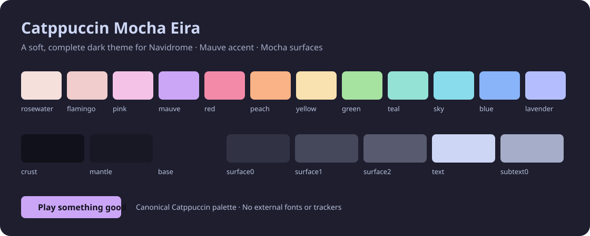
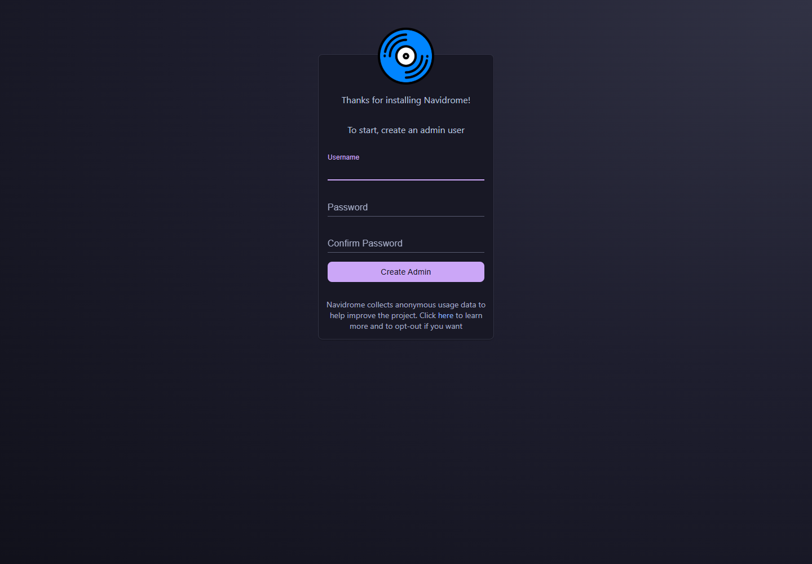
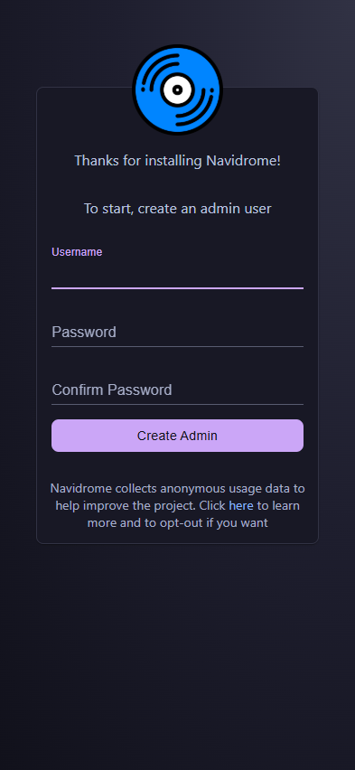

# Catppuccin Mocha Eira for Navidrome



A complete, mauve-accented **Catppuccin Mocha** theme for Navidrome. It uses the canonical Mocha palette for the application shell, forms, tables, menus, alerts, login screen and both desktop/mobile player styles.

> Navidrome already includes a theme called **Catppuccin Mocha**. This project is a separate implementation, **Catppuccin Mocha Eira**, with consistent surfaces, semantic states, readable button labels and visible keyboard focus. It does not claim to be the original or an official Catppuccin port.

## What changes

- Base, Mantle and Crust surfaces instead of mixed neutral grays.
- Mauve primary actions, blue links and clear semantic error/success colors.
- Consistent table headers, selection, menus, dialogs, tooltips and notifications.
- A quiet Mocha login background with no remote image/font dependencies added by the theme.
- Matching desktop/mobile player controls and focus outlines.
- Navidrome's existing fonts, icons, layout, accounts, library and authentication are preserved.

The theme does **not** alter network exposure, DNS, certificates or application authentication.

## Compatibility

Tested target: **Navidrome v0.64.2**, upstream commit `101145742f4762164202cb4858c9126258bdc463`.

Navidrome 0.64.2 compiles themes into its frontend. It does not load these files from a runtime `data/themes` directory. Installing this custom theme therefore requires a frontend/server rebuild; a normal server upgrade replaces the customized frontend and requires rebuilding again.

The theme selector entry and `DefaultTheme` value are exactly:

```toml
DefaultTheme = 'Catppuccin Mocha Eira'
```

Existing browsers can retain an explicit theme preference. Select **Catppuccin Mocha Eira** from the theme selector if that browser does not follow the new server default. Do not clear authentication or unrelated browser storage.

## Build from source

Prerequisites: Git, Node.js with npm, Python 3.11+, Go with automatic toolchain support, and a working C compiler. Windows also needs Git Bash and MinGW-w64 GCC on PATH. The pinned upstream `go.mod` selects its required Go toolchain; downloads and build caches stay in the ignored project cache.

```sh
git clone https://github.com/EiraWalker/navidrome-catppuccin-mocha.git
cd navidrome-catppuccin-mocha
npm test
python scripts/build.py
```

The build script:

1. Fetches the pinned upstream release and verifies the exact commit.
2. Registers only the new theme and copies the three theme modules.
3. Uses upstream's lockfile to install its frontend dependencies.
4. Runs the upstream theme/reducer tests and creates the production frontend.
5. Compiles Navidrome with `netgo,sqlite_fts5` and a clearly marked `0.64.2+mocha.1` version.
6. Writes `dist/navidrome.exe` (Windows) and a SHA-256 build manifest.

`--prepare-only`, `--ui-only`, and `--server-only` support reviewing or resuming the same build. The script refuses an unexpected upstream commit or unrelated tracked edits; it does not reset an existing checkout.

## Install on Windows

Back up your deployment. The included installer supports the standard `<root>/bin/navidrome.exe` layout with `navidrome.toml` at the root and an existing native Windows service.

From an **Administrator PowerShell** in this repository:

```powershell
.\scripts\Install-Windows.ps1 -NavidromeRoot 'E:\Navidrome'
```

The installer verifies the candidate's build manifest, creates a private backup of the original binary/configuration and a native database backup, stops only the selected Navidrome service, installs the customized binary, sets `DefaultTheme`, restarts it and checks that users are preserved. It does not change music paths, network/proxy configuration or other applications. A deployment failure attempts to restore the original binary and the unchanged configuration.

The deployment backup and `deployment/theme-apply-result.json` are local private artifacts. Never commit or upload them. For manual rollback, review the recorded backup and restore its binary/configuration during a service stop; do not overwrite later configuration changes or restore an older database blindly.

If you only want upstream's existing stock theme, no custom build is needed: choose **Catppuccin Mocha**, not this project's **Catppuccin Mocha Eira**.

## Browser preview



<details>
<summary>Mobile viewport</summary>



</details>

These are real screenshots of the compiled program's first-run setup screen in an isolated, loopback-only preview instance. They contain no real account or library data. See [verification results](docs/verification.md) for what was actually exercised.

## Theme development

- `src/mocha.js`: canonical palette tokens.
- `src/catppuccinMochaEira.js`: Material-UI 4 / Navidrome theme object.
- `src/catppuccinMochaEira.css.js`: player styles.
- `patches/register-theme.patch`: additive upstream registry change.
- `theme.json`: theme identity and pinned compatibility.
- `tests/theme.test.mjs`: structure, palette, contrast and safety checks.

```sh
npm test
npm run preview
```

The SVG is a palette/design preview, not a fabricated screenshot of a running installation. Real browser/build verification is performed separately. Color checks cover WCAG AA normal-text contrast for the documented text/button/semantic pairs; they do not claim an accessibility certification of all upstream components.

## License and attribution

Theme and integration code: **GPL-3.0-only**, copyright 2026 EiraWalker. Navidrome is GPL-3.0; its full license is retained in `LICENSE`. Catppuccin palette data is MIT, copyright Catppuccin; its notice is in `LICENSES/Catppuccin-MIT.txt`.

Palette source: [catppuccin/palette](https://github.com/catppuccin/palette) at `07d02aa110ef9eb7e7427afca5c73ba9cf7f8ebd`. Theme integration follows [Navidrome's documented theme interface](https://www.navidrome.org/docs/developers/creating-themes/). This repository is not affiliated with either project.
